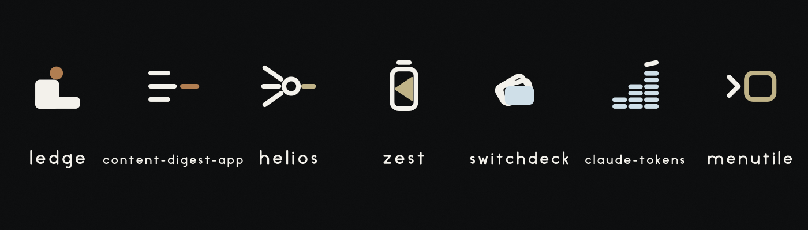

  <picture>
    <source media="(prefers-color-scheme: dark)"  srcset="design/github/profile-banner-dark.svg">
    <source media="(prefers-color-scheme: light)" srcset="design/github/profile-banner-light.svg">
    
  </picture>

# Shashank Karpal

Growth and partnerships at [KodeKloud](https://kodekloud.com), covering IMEA, APAC, and CIS. Based in Dubai.

Personal account. Everything here is built in my own time and does not represent KodeKloud.

## Why these exist

I am not a software engineer. My degree is in electronics, and software was never my trade. AI assistants closed the gap between "this annoys me" and "I fixed it," so now I build small tools for my own problems. Claude writes most of the code. I do the product thinking, the testing, and the stubborn iteration.

I have ADHD-C. Most of these close a loop my brain leaves open. Maybe one of them closes yours.

## Apps

- **[ledge](https://github.com/ShashankKarpal/ledge).** ADHD-first sidebar notepad for Mac, iPhone, iPad, and Apple Watch. One hotkey, plain Markdown in your own iCloud Drive folder, capture from Siri and the Watch, and every unchecked box resurfaces until you deal with it.
- **[zest](https://github.com/ShashankKarpal/zest).** Menu bar battery command center for Apple Silicon Macs. Power flow, battery health trends, every Apple device's battery in one place, and alerts you set yourself.
- **[content-digest-app](https://github.com/ShashankKarpal/content-digest-app).** Save a link from your Mac, iPhone, or Chrome. A local model summarizes and tags it, you can ask questions across everything you saved, and a short brief lands in your inbox each morning.
- **[helios](https://github.com/ShashankKarpal/helios).** Local-only personal health system. Reads every wearable through Apple Health, trusts one device per metric instead of averaging them, compares you to your own baselines, and lets a local model explain the numbers without inventing any.

## Smaller tools

- **[switchdeck](https://github.com/ShashankKarpal/switchdeck).** Menu bar switcher for two Claude Code accounts, with every quota window, its reset time, and your pace.
- **[claude-tokens](https://github.com/ShashankKarpal/claude-tokens).** Desktop widget showing today's Claude Code token use and what it would cost at API prices.
- **[menutile](https://github.com/ShashankKarpal/menutile).** Turns any SwiftBar or xbar script into its own signed menu bar app, so macOS gives it a real name and real notifications.

## Install

Ledge and Zest are signed, notarized, and checksum-pinned through my Homebrew tap:

    brew install --cask shashankkarpal/tap/ledge
    brew install --cask shashankkarpal/tap/zest

Local models where possible. No accounts, no telemetry.

## Elsewhere

- [LinkedIn](https://linkedin.com/in/shashankkarpal)
- [From AI Literacy to AI Readiness: The 2026 Playbook for Universities](https://kode.wiki/4iYMg5D)
